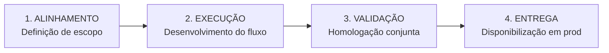

# Skill: Meeting to Knowledge (Síntese Executiva & Stakeholders)

Esta skill transforma notas brutas, transcrições de áudio e discussões de alinhamento em documentação executiva padronizada, respeitando o princípio da **Linha do Tempo Única**, a diagramação **Mermaid anti-distorção** e o **tom específico por stakeholder**.

---

## 1. Princípios de Governança

1. **Linha do Tempo Única (Sem Duplicação de Arquivos)**:
   - **NÃO crie um novo arquivo** se o assunto já possuir um `.mdx` no repositório.
   - Sempre busque o arquivo correspondente e adicione um novo registro na `<Timeline />`.
   - Crie um novo `.mdx` apenas se o assunto for inédito, utilizando o [`00-meta/TEMPLATE_NOTA.mdx`](file:///./00-meta/TEMPLATE_NOTA.mdx).
2. **Preservação Histórica**:
   - Nunca apague diagnósticos, decisões ou versões anteriores de um relatório. Organize os novos fatos em seções cronológicas ou entradas na linha do tempo.

---

## 2. Matriz de Tom por Stakeholder (Regra Crítica)

Identifique os participantes ou contexto da reunião antes de redigir:

| Contexto / Stakeholder | Tom de Comunicação Exigido | O que DEVE Conter | O que é PROIBIDO |
| :--- | :--- | :--- | :--- |
| **Cliente Corporativo (CSC / Stakeholder Executivo)** | **Estritamente formal e de negócios** (Linguagem não-técnica) | Nomes dos hotéis, números de chamados, impactos operacionais, prazos e datas. | Jargões de TI, IPs, logs de erro brutos, nomes de scripts, variáveis e bancos. |
| **Empresa / Startup (Produto & Engenharia)** | **Técnico-executivo** | Arquitetura BFF, endpoints, regras de idempotência, testes e trechos cirúrgicos de código (< 10 linhas). | Descrições vagas ou omissão de causas-raiz técnicas. |
| **Tríade & Somos1 (Comercial / CRM)** | **Estratégico / Comercial** | Funil de agendamentos, conversão, WhatsApp, termos contratuais e SLAs. | Complexidade desnecessária de infraestrutura. |
| **RPG (Ordem Paranormal 2)** | **Livro de Regras Oficial** | Tom didático, mecânicas numeradas, demarcação explícita com `<Badge>Oficial</Badge>` ou `<Badge>Homebrew</Badge>`. | Misturar teorias de fãs com regras oficiais sem demarcação. |

---

## 3. Padrão de Diagramas Mermaid (Anti-Distorção & Anti-Orphan)

Se a reunião envolveu fluxos ou decisões sequenciais, resuma em um bloco `mermaid` seguindo estritamente:

- **Sem tags HTML**: Nunca use `<b>`, `<strong>` ou `<div>` dentro de nós do Mermaid (o parser do MDX vaza texto literal). Use caixa alta ou `<br/>`.
- **Rótulos com Aspas Duplas**: Sempre use `A["Passo 1<br/>Descrição"] --> B["Passo 2"]`.
- **Dimensões Contidas (< 260px)**:
  - Para etapas sequenciais (3 a 4 passos): Use `flowchart LR`.
  - Para comparativos ou opções: Use cards horizontais (`O1 --- O2 --- O3`).
  - **Evite árvores largas**: Nunca crie nós com 4+ ramos horizontais em `flowchart TD` (a tipografia encolhe para 3pt no PDF).



---

## 4. Protocolo de Execução (Passo a Passo)

### Passo 1: Triagem do Contexto
1. Qual é o projeto / cliente? (ex: Empresa / Startup, Atlântica, Tríade, Pessoal).
2. Quem participou? Há restrições de tom (ex: Stakeholder Executivo)?
3. Já existe um arquivo sobre o assunto? (Consulte [`ORGANIZATION.md`](file:///./ORGANIZATION.md) ou faça uma busca no repositório).

### Passo 2: Estruturação do Conteúdo
Extraia da transcrição/ata:
- **Resumo Executivo / Objetivos**: 2 a 3 parágrafos claros.
- **Decisões Tomadas**: Lista de deliberações com seus responsáveis.
- **Plano de Ação / Próximos Passos**: Tabela com `Ação | Responsável | Prazo | Status`.
- **Diagrama Mermaid**: Visualização sintética do processo acordado (se aplicável).

### Passo 3: Inserção na Linha do Tempo
No arquivo `.mdx` de destino, adicione um item no componente `<Timeline />`:
```jsx
<Timeline
  items={[
    {
      date: "YYYY-MM-DD",
      title: "Reunião de Alinhamento: [Tema Central]",
      content: "Decisões principais: [...]",
      status: "Concluído",
    },
  ]}
/>
```

### Passo 4: Hiperlinks Cruzados
Crie links para outros documentos correlatos existentes no repositório (ex: `[Dossiê da Atlântica](../../trabalho/join4/clientes/atlantica/...)`).

### Passo 5: Registro em Memória
Adicione uma entrada sintética no [`MEMORY.md`](file:///./MEMORY.md) com a data, documento atualizado e resumo da reunião.
