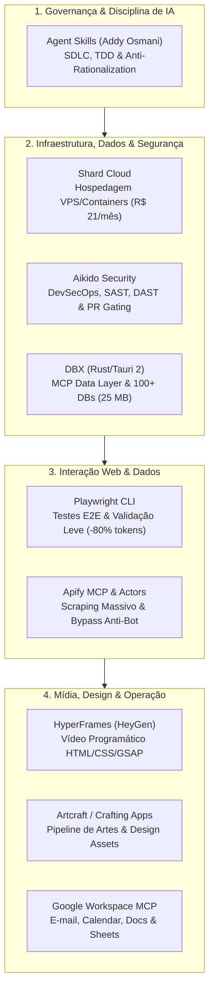

import { Timeline } from "../components/Timeline.jsx";
import { Badge } from "../components/Badge.jsx";
import { Callout } from "../components/Callout.jsx";
import { LinkCard } from "../components/LinkCard.jsx";

# Guia da Stack Tecnológica Homologada para Planejamento de Projetos e Arquitetura

<Badge label="Padrão Arquitetural" type="trabalho" />
<Badge label="Governança de IA" type="tecnologia" />
<Badge label="Ativo" type="status" />

## Visão Geral & Objetivo

Este documento é a **referência técnica mandatória** para os Agentes de IA (Google Antigravity e Claude) e desenvolvedores ao planejar novos projetos, desenhar arquiteturas de software, orquestrar bots ou especificar soluções técnicas no repositório.

A stack homologada consolida **9 pilares tecnológicos** auditados e validados em pesquisas aprofundadas, combinando baixo custo operacional, alta escalabilidade, conformidade com DevSecOps e máxima eficiência no consumo de tokens para agentes autônomos.

---

## 1. Matriz de Decisão Arquitetural (Stack Homologada)

Ao planejar qualquer sistema, robô ou produto, consulte a tabela para selecionar os componentes padrão:

| Domínio do Projeto | Tecnologia Homologada | Função Técnica Primária | Custo Base | Documento de Referência |
| :--- | :--- | :--- | :--- | :--- |
| **Infraestrutura em Nuvem & Backend** | **Shard Cloud** (`shardcloud.app`) | Hospedagem de APIs (FastAPI/Node), workers de background, webhooks e bots em containers de alta performance. | R$ 21,00/mês | [Shard Cloud Docs](https://shardcloud.app) |
| **Segurança DevSecOps & CI/CD** | **Aikido Security** (`aikido.dev`) | Varredura contínua de vulnerabilidades (SAST/DAST), secrets scanning (`.env`), auditoria de containers e bloqueio de PRs vulneráveis no GitHub. | Gratuito (Free) / ~$15 dev | [Aikido Security](https://aikido.dev) |
| **Geração de Imagens & Design Assets** | **Artcraft / Crafting Apps / Storytold** | Criação, curadoria e geração automatizada de ilustrações, texturas, sprites, miniaturas e design visual. | Varia por tier | [Artcraft AI](https://artcraft.ai) |
| **Produção de Vídeo Programático** | **HyperFrames (HeyGen)** | Compilação determinística de vídeos MP4 via HTML, CSS/Tailwind e GSAP executada via CLI ou pipeline autônoma de IA. | 100% Gratuito ($0 local) | [Open Agent Skills](https://github.com/addyosmani/agent-skills) |
| **Produtividade & Handshake Comercial** | **Google Workspace (MCP / APIs)** | Integração de formulários de discovery (Forms), minutas de contratos (Docs), CRM de dados (Sheets) e reuniões (Calendar/Meet). | ~$6 a $14/usuário/mês | [Open Agent Skills](https://github.com/addyosmani/agent-skills) |
| **Web Scraping Massivo & Anti-Bot** | **Apify (Cloud Actors & MCP)** | Mineração de dados externos, contorno de proteções Cloudflare/CAPTCHA e acesso a catálogo de +7.000 raspadores na nuvem. | Free ($5 crédito) / $49 mês | [Open Agent Skills](https://github.com/addyosmani/agent-skills) |
| **Governança SDLC & Disciplina de IA** | **Agent Skills (Addy Osmani)** | Metodologia mandatória de engenharia: TDD, tabelas anti-racionalização, dúvida epistêmica e progressive disclosure em `.agents/skills/`. | 100% Gratuito ($0) | [Open Agent Skills](https://github.com/addyosmani/agent-skills) |
| **Navegação Web Leve & Testes E2E** | **Playwright CLI (`@playwright/cli`)** | Interação autônoma com navegadores locais, auditoria visual responsiva e criação de testes de ponta a ponta com economia de 80% de tokens. | 100% Gratuito ($0) | [Open Agent Skills](https://github.com/addyosmani/agent-skills) |
| **Bancos de Dados & MCP Data Layer** | **DBX (`t8y2/dbx`)** | Cliente universal ultra-leve em Rust/Tauri 2 (25 MB) com suporte a 100+ bancos e servidor MCP seguro para agentes de IA inspecionarem schemas e queries. | 100% Gratuito ($0 / Open Source) | [DBX GitHub Repo](https://github.com/t8y2/dbx) |
| **Memória Contínua de Agentes** | **OptMem Pattern** | Prompt bounded de 426 tokens para persistência de estado e memória episódica sem infraestrutura de banco vetorial. | 100% Gratuito ($0) | [OptMem Pattern Skill](../.agents/skills/optmem-pattern/SKILL.md) |
| **Utilitários JavaScript/TypeScript** | **es-toolkit (`toss/es-toolkit`)** | Biblioteca utilitária moderna para microsserviços Node/TS (2-3x mais rápida e até 97% menor que o Lodash). | 100% Gratuito ($0 / MIT) | [es-toolkit GitHub](https://github.com/toss/es-toolkit) |

---

## 2. Diretrizes de Aplicação por Tipo de Projeto

<Callout title="Regra de Ouro do Planejamento" type="important">
  Nenhum projeto de engenharia ou produto deve planejar infraestrutura do zero sem primeiro avaliar o aproveitamento direto dessa stack homologada.
</Callout>

### 2.1 Projetos de Automação de Mídia e Conteúdo (ex: Vídeos Dark, Redes Sociais)
- **Vídeo**: Usar estritamente **HyperFrames** para renderização via HTML/CSS/GSAP determinístico.
- **Artes e Capas**: Usar **Artcraft / Storytold / photocraft-cli** para miniaturas e ilustrações.
- **Inteligência de Pautas**: Acionar **Apify MCP** para raspagem contínua de vídeos outliers no YouTube/TikTok sem risco de ban de IP.

### 2.2 Projetos de Software Distribuído e Desktop (ex: Cliente DePIN Robux)
- **Backend & APIs**: Hospedar endpoints FastAPI e ledgers na **Shard Cloud** por R$ 21/mês.
- **DevSecOps**: Conectar o repositório ao **Aikido Security** no GitHub para PR Gating obrigatório contra vazamento de segredos e falhas de dependências.
- **Governança de Código com Programadores Independentes**: Aplicar as **Agent Skills** (Addy Osmani) no repositório, garantindo TDD e impedindo commits sem cobertura de testes.

### 2.3 Projetos Comerciais e SaaS da Triade (ex: Somos1 Tattoo Studio)
- **Onboarding Comercial**: Integrar **Google Forms** + **Google Docs** para gerar contratos assináveis e agendamento automático no **Google Calendar**.
- **Testes do Fluxo de Venda**: Criar suítes de testes E2E com **Playwright CLI** para validar o modal de agendamento online e o checkout PIX em dispositivos móveis.
- **Segurança da Plataforma**: Blindar o Supabase e as APIs via **Aikido Security**.

### 2.4 Demandas de Produto e Clientes da Join4 (ex: Atlântica Hotels, ConsultasPortal)
- **Depuração de Telas e Formulários**: Empregar **Playwright CLI** no terminal para simular navegações no Lecom BPM e isolar bugs de JavaScript em minutos.
- **Comunicação com Stakeholders de Negócio (David Oliveira)**: Usar o **Google Workspace** (Google Sheets) para consolidar painéis em linguagem puramente de negócios.
- **Governança de Tarefas de Produto**: Seguir o modelo de fatiamento vertical das **Agent Skills** para alterações de ETL e Kubernetes.

### 2.5 Diretrizes de Minimalismo Arquitetural & Anti-Bloat (YAGNI)
- **Prevenção de Inchaço no Repositório**: Proibido instalar runtimes pesados (PyTorch/CUDA/HuggingFace) ou containers Docker permanentes no repositório de anotações.
- **Memória de Agentes Ultracompacta**: Adotar o padrão **OptMem** (`.agents/skills/optmem-pattern/`) com arquivos textuais de ~426 tokens em vez de clusters vetoriais dedicados.
- **Padrão de Utilitários Node/TS**: Em microsserviços e scripts JavaScript/TypeScript, usar estritamente o **es-toolkit** em substituição ao Lodash.
- **Isolamento de CLIs de Host**: Utilitários como Fabric e Monolith pertencem ao sistema operacional do desenvolvedor, nunca à raiz do projeto.

---

## 3. Aplicação Direta no Próprio Repositório (Second Brain)

Além de orientar o desenvolvimento de sistemas externos, essas tecnologias possuem aplicação imediata na operação, governança e automação deste repositório:

| Ferramenta | Aplicação Prática no Repositório | Benefício Concreto |
| :--- | :--- | :--- |
| **Agent Skills (Addy Osmani)** | Implementação de tabelas anti-racionalização e portões de verificação no hub `.agents/skills/`. | Impede que agentes ignorem as 18 diretrizes do `AGENTS.md` ou pulem os linters e validadores do Second Brain. |
| **Playwright CLI (`@playwright/cli`)** | Inspeção visual headless dos componentes MDX (`components/`) e checagem de renderização de páginas HTML pré-PDF. | Validação visual de diagramas Mermaid e componentes React com altíssima economia de tokens de contexto. |
| **Aikido Security (`aikido.dev`)** | Conexão do repositório ao GitHub com varredura contínua de segredos (secrets scanning) e SAST nos scripts Python (`scripts/`). | Garante que chaves de API (tokens do ClickUp, credenciais e `.env`) nunca sejam commitadas no repositório. |
| **Google Workspace (MCP / APIs)** | Ingestão automática de atas recebidas por e-mail ou Google Docs via `meeting-to-knowledge` e upload de relatórios semanais no Drive. | Automatiza a entrada de notas brutas e facilita a distribuição de PDFs compilados para equipes externas. |
| **Apify (Cloud Actors & MCP)** | Motor de pesquisa para agentes quando solicitados a produzir novas análises de mercado em `projetos/pesquisas/`. | Elimina a limitação de busca básica, extraindo dados ricos de portais, fóruns e documentações web. |
| **Shard Cloud (`shardcloud.app`)** | Hospedagem de um bot serverless contínuo ou webhook do repositório rodando em container por R$ 21,00/mês. | Permite compilação de PDFs em nuvem, triggers automáticos via GitHub Actions e bots de consulta RAG 24/7. |
| **Artcraft / Storytold** | Geração de artes visuais, ilustrações conceituais e retratos para a pasta de RPG e capas de relatórios e capas de relatórios. | Enriquecimento visual de dossiês e manuais de RPG no formato oficial de livro de regras. |
| **HyperFrames (HeyGen)** | Compilação de pequenos vídeos demonstrativos de novos componentes React ou changelogs da base de notas. | Criação de changelogs animados em vídeo diretamente a partir do histórico de `MEMORY.md`. |
| **DBX (`t8y2/dbx`)** | Servidor MCP nativo (`@dbx-app/mcp-server`) para que agentes de IA consultem bases locais SQLite, DuckDB e PostgreSQL/Supabase. | Permite que os agentes inspecionem schemas e realizem queries em modo `read_only` sem alucinação de dados. |
| **OptMem Pattern** | Padrão textual de retenção de memória em `.agents/skills/optmem-pattern/` para subagentes locais. | Memória episódica com custo de apenas ~426 tokens sem exigir banco vetorial local. |
| **es-toolkit (`toss/es-toolkit`)** | Padronização de utilitários em scripts e pacotes Node.js/TypeScript. | Redução de até 97% no bundle e maior velocidade de execução que o Lodash. |

---

## Linha do Tempo (Atualizações Cronológicas)

<Timeline
  items={[
    {
      date: "2026-10-14",
      title: "Homologação do Padrão OptMem, es-toolkit e Regras Anti-Bloat",
      content: "Instituição formal do OptMem para memória de agentes, adoção do es-toolkit em TypeScript e diretrizes estritas contra inchaço técnico no repositório.",
      status: "Concluído",
    },
    {
      date: "2026-10-14",
      title: "Inclusão do DBX como 9º Pilar da Stack Homologada",
      content: "Homologação oficial do DBX (Rust/Tauri 2) como camada padrão de dados e MCP Server para conexões multi-bancos e consultas seguras de agentes de IA.",
      status: "Concluído",
    },
    {
      date: "2026-10-14",
      title: "Mapeamento de Aplicação Direta no Repositório",
      content: "Detalhamento de como os 8 pilares da stack homologada são aplicados na infraestrutura interna, governança, segurança e enriquecimento do Second Brain.",
      status: "Concluído",
    },
    {
      date: "2026-10-14",
      title: "Formalização da Stack Homologada do Repositório",
      content: "Consolidação dos 8 pilares tecnológicos oficiais para planejamento de projetos: Shard Cloud, Aikido Security, Artcraft, HyperFrames, Google Workspace, Apify, Agent Skills e Playwright CLI.",
      status: "Concluído",
    },
  ]}
/>

---

## Assuntos Relacionados

- [`TEMPLATE_NOTA.mdx`](TEMPLATE_NOTA.mdx) — Template padrão para criação de novos documentos e relatórios.
- [`TEMPLATE_TAREFA.mdx`](TEMPLATE_TAREFA.mdx) — Template mestre para acompanhamento e execução de tarefas.
- [`ESTILO_DE_ESCRITA.md`](ESTILO_DE_ESCRITA.md) — Guia de tom, linguagem e diagramação de documentos.
