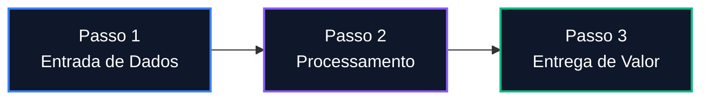

import { Timeline } from "../components/Timeline.jsx";
import { Badge } from "../components/Badge.jsx";
import { Callout } from "../components/Callout.jsx";
import { LinkCard } from "../components/LinkCard.jsx";

# Título do Assunto

<Badge label="Join4" type="trabalho" />
<Badge label="Ativo" type="projeto" />

## Visão Geral & Resumo

Resumo conciso do assunto, objetivo principal e contexto geral.

---

## Detalhamento & Conteúdo Principal

Descrição completa dos conceitos, etapas, regras ou arquitetura relacionada a este assunto.

<Callout title="Ponto Importante" type="warning">
  Adicione observações cruciais ou avisos aqui.
</Callout>

---

## Linha do Tempo (Atualizações Cronológicas)

> **Nota para IAs**: Nunca crie um novo arquivo para atualizar este mesmo assunto em datas diferentes. Adicione novos blocos cronológicos abaixo nesta seção.

<Timeline
  items={[
    {
      date: "2026-08-21",
      title: "Criação do Documento",
      content: "Registro inicial do assunto no ambiente de anotações.",
      status: "Inicial",
    },
  ]}
/>

---

## Assuntos Relacionados

- [`Outro Assunto`](../../caminho/outro-assunto.mdx) — Descrição rápida da relação.
