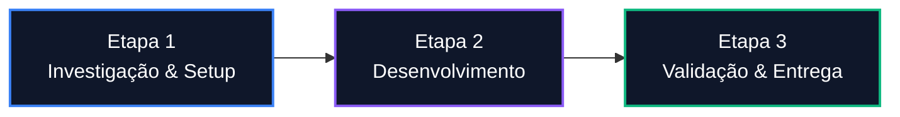

import { Timeline } from "../components/Timeline.jsx";
import { Badge } from "../components/Badge.jsx";
import { Callout } from "../components/Callout.jsx";
import { LinkCard } from "../components/LinkCard.jsx";

# [TASK-000] Nome Descritivo da Tarefa

<Badge label="Engenharia de Produto" type="trabalho" />
<Badge label="Status: Em Andamento" type="ideia" />
<Badge label="Prioridade: Alta" type="projeto" />

## Visão Geral & Metadados ClickUp

Descrição concisa do objetivo desta tarefa, o problema que resolve e a motivação inicial.

- **ClickUp ID**: `[ID_CLICKUP]` | **Link**: [Abrir no ClickUp](https://app.clickup.com/t/...)
- **Lista / Pasta**: `Portal` > `ETL`
- **Responsável / Executor**: Seu Nome
- **Prazo Estimado**: DD/MM/AAAA
- **Objetivo Central**: Definição de sucesso mensurável.

---

## 1. Parecer Técnico & Análise Inicial da IA

<Callout title="Análise Automatizada de Engenharia" type="info">
  Diagnóstico preliminar gerado automaticamente no recebimento/atribuição da tarefa no ClickUp.
</Callout>

### 1.1 Diagnóstico do Problema
Resumo técnico da causa-raiz ou requisito de negócio extraído da descrição e das discussões do card.

### 1.2 Impacto Arquitetural no Ecossistema Join4
- **Módulos Afetados**: (ex: `etl-piloto`, `portal-bff`, `luxia-multi-tenant`, `schemas-gold`).
- **Riscos & Pontos Críticos**: Cuidados com isolamento multi-tenant, concorrência, idempotência ou quebra de contratos de API.

### 1.3 Checklist Técnico Recomendado (Plano de Ação Sugerido)
- [ ] Passo 1: Inspeção de código e logs nos repositórios relevantes.
- [ ] Passo 2: Implementação cirúrgica com foco na regra de negócio.
- [ ] Passo 3: Testes unitários/integração locais (Docker/WSL).
- [ ] Passo 4: Atualização de documentação e validação de homologação.

---

## 2. Escopo Inicial & Requisitos

### 2.1 O que DEVE ser feito (In Scope)
- [ ] Entregável 1: Descrição detalhada do que será construído.
- [ ] Entregável 2: Requisito técnico ou operacional.
- [ ] Entregável 3: Testes e validações necessárias.

### 2.2 O que NÃO faz parte (Out of Scope)
- O que não será coberto nesta iteração para evitar aumento descontrolado de escopo (*scope creep*).

### 2.3 Critérios de Aceite (Definition of Done - DoD)
- [ ] Código compilando e sem erros de lint/tipagem.
- [ ] Testes executados e validados.
- [ ] Documentação e histórico atualizados.

---

## 3. Planejamento & Arquitetura Visual

---

## 4. Registro do Processo de Execução

Documentação contínua de descobertas, decisões tomadas, comandos executados e alterações de rumo durante o desenvolvimento.

### 4.1 Descobertas Técnicas & Decisões
- **Decisão 1**: Por que foi escolhida a abordagem X em vez de Y.
- **Descoberta 2**: Nuance identificada no ambiente ou dependência.

### 4.2 Tabela de Ações & Comandos Relevantes

| Fase | Ação Executada | Artefato / Arquivo | Resultado Obtido |
| :--- | :--- | :--- | :--- |
| Investigação | Mapeamento de dependências | `package.json` | Versões alinhadas |
| Construção | Implementação do módulo | `src/index.ts` | Testes locais passando |

<Callout title="Ponto de Atenção / Bloqueio Superado" type="info">
  Caso ocorra algum impedimento, descreva aqui o sintoma, a causa identificada e a solução contornada.
</Callout>

---

## 5. Evolução & Próximos Passos

- **Status Atual**: Onde o trabalho parou na sessão atual.
- **Próximas Ações**:
  - [ ] Passo imediato para a próxima retomada.
  - [ ] Homologação ou entrega final no ClickUp.

---

## Linha do Tempo (Rastreamento Cronológico)

> **Regra de Ouro**: Adicione cada avanço, mudança de status ou sessão de trabalho aqui para preservar o histórico vivo e sem perda de contexto.

<Timeline
  items={[
    {
      date: "2026-10-13",
      title: "Kickoff e Análise Inicial Automatizada da IA",
      content: "Atribuição da tarefa no ClickUp, extração dos requisitos técnicos e geração da análise preliminar de arquitetura.",
      status: "Início",
    },
  ]}
/>

---

## Assuntos Relacionados

- [Painel Central de Tarefas (Engenharia de Produto)](../trabalho/tarefas/README.mdx)
- [Template Geral de Notas](TEMPLATE_NOTA.mdx)
