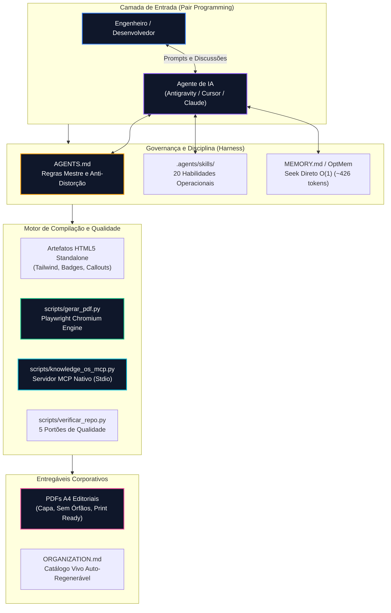

# Agentic Knowledge OS

> **The Professional AI-Augmented Second Brain & Knowledge Operating System.**  
> Built for autonomous pair programming with **Google Antigravity**, **Cursor**, and **Claude Code**, powered by an editorial A4 PDF publishing engine, native Model Context Protocol (MCP) server, and 20 production-grade Agent Skills.

---

<p align="center">
  
  
  
  
  
  
  
  
</p>

---

## O que é o Agentic Knowledge OS?

A maioria dos repositórios de notas e bases de conhecimento em Markdown sofre de três falhas estruturais graves quando operados por agentes autônomos de IA:
1. **Proliferação Caótica de Arquivos**: Agentes criam arquivos redundantes a cada nova sessão, gerando silos isolados e duplicidade de escopo.
2. **Degradação e Diluição de Contexto**: Bancos vetoriais pesados trazem ruído de busca semântica e esgotam janelas de contexto com conteúdo irrelevante.
3. **Ausência de Rigor de Engenharia**: Falta de testes automatizados, quebras frequentes em diagramas e entrega de relatórios visuais desalinhados.

O **Agentic Knowledge OS** resolve esses problemas transformando o repositório em um **Harness de Engenharia Completo**:
- **Diretrizes Mestre Anti-Alucinação (`AGENTS.md`)**: Regras inquebráveis de proporção de diagramas Mermaid, estilo corporativo, preservação histórica de relatórios e blocos cirúrgicos de código (< 10 linhas).
- **Servidor MCP Nativo (`scripts/knowledge_os_mcp.py`)**: Interface padronizada que expõe as capacidades do repositório (pesquisa indexada, geração de PDF e gravação de memória) diretamente como ferramentas nativas para qualquer agente.
- **Formato Dual (HTML5 Standalone e Markdown)**: Relatórios corporativos e dossiês técnicos adotam HTML5 puro com Tailwind CSS, eliminando dependências frágeis de compilação MDX e garantindo visualização instantânea na IDE (`Ctrl + Shift + V`).
- **Motor de PDF Editorial A4 (`scripts/gerar_pdf.py`)**: Compilação baseada em Playwright Chromium com capa executiva, rodapés dinâmicos, paginação CSS Paged Media e algoritmos que eliminam quebras órfãs (`anti-orphan page break`).
- **Memória Permanente OptMem (Victor Taelin)**: Arquitetura episódica em árvore binária com seek direto em tempo constante ($O(1)$) e orçamento fixo de leitura (~426 tokens), evitando a sobrecarga de bancos vetoriais.
- **Portões de Qualidade Pré-Commit**: Esteira rigorosa de 5 etapas que bloqueia commits que não atendam aos padrões de testes, links, metadados e formatação.
- **Hub de 20 Agent Skills**: Extensões operacionais modulares prontas para serem invocadas sob demanda por agentes autônomos.

---

## Arquitetura do Sistema



---

## Servidor MCP Nativo (Model Context Protocol)

O repositório inclui um servidor MCP nativo compatível com a especificação oficial, permitindo que ferramentas como Google Antigravity, Claude Code, Cursor, Zed e Goose executem comandos diretamente no ecossistema:

```bash
python scripts/knowledge_os_mcp.py
```

### Ferramentas Expostas pelo Servidor

| Ferramenta | Descrição |
| :--- | :--- |
| `generate_pdf` | Compila arquivos `.html` ou notas `.md` em PDFs executivos A4 com Playwright Chromium. |
| `validate_document` | Executa linter completo de anti-órfãos, validação de sintaxe e conformidade de links. |
| `search_knowledge` | Busca estruturada em tempo constante no índice do repositório sem varredura em disco. |
| `optmem_record` | Grava um fato novo consolidado (máx. 280 bytes) na árvore binária de memória de longo prazo. |
| `optmem_wake` | Retorna o estado mental consolidado na inicialização de uma nova sessão de trabalho. |
| `optmem_recall` | Executa busca exata por padrões regex em todo o histórico de memórias persistidas. |

---

## Ciclo de Vida da Memória Contínua (OptMem)

Baseado no padrão arquitetural proposto por Victor Taelin, o agente não depende de embeddings vetoriais lentos para recuperar fatos essenciais. A persistência é gerenciada via CLI:

```bash
# Inicializar a árvore binária de memória
python scripts/optmem_memo.py init

# Carregar o estado mental no início da sessão (obrigatório para agentes)
python scripts/optmem_memo.py wake

# Gravar uma decisão técnica ou regra de negócio
python scripts/optmem_memo.py note "Padrão de entrega: artefatos HTML5 com Tailwind e compilação em PDF A4."

# Recuperar fatos históricos por palavra-chave
python scripts/optmem_memo.py recall "HTML5"
```

---

## Início Rápido (Quickstart)

### 1. Clonar o Repositório
```bash
git clone https://github.com/SEU_USUARIO/agentic-knowledge-os.git
cd agentic-knowledge-os
```

### 2. Executar a Inicialização Automática
```bash
python scripts/setup.py
```
*O assistente verifica as dependências do sistema, instala o Playwright Chromium e configura o ambiente operacional.*

### 3. Rodar a Suíte de Verificação Integral (5 Portões)
```bash
python scripts/verificar_repo.py
```

### 4. Compilar o Primeiro PDF Editorial
```bash
python scripts/gerar_pdf.py exemplos/01-ata-reuniao-arquitetura.html
```
*O PDF corporativo será gerado instantaneamente em `exemplos/pdf/` com capa executiva e proteção anti-órfãos.*

---

## Comandos do Repositório (CLI)

| Comando | Descrição |
| :--- | :--- |
| `python scripts/gerar_pdf.py <arquivo.html>` | Compila um artefato `.html` ou nota `.md` individual em PDF corporativo. |
| `python scripts/gerar_pdf.py --dir <pasta>` | Compila em lote todos os documentos de uma pasta. |
| `python scripts/gerar_pdf.py <arquivo.html> --check-only` | Linter rápido: valida regras de diagramas, tags e quebras sem renderizar. |
| `python scripts/verificar_repo.py` | Executa os 5 portões de qualidade pré-commit (testes, links, frontmatter, catálogo, estilo). |
| `python scripts/validar_frontmatter.py` | Garante que todas as notas possuem metadados válidos. |
| `python scripts/validar_links.py` | Detecta links quebrados ou hiperlinks órfãos em todo o repositório. |
| `python scripts/gerar_organization.py` | Atualiza a matriz de categorias e links rápidos do `ORGANIZATION.md`. |

---

## Visualização em Tempo Real na IDE (1 Clique)

Os artefatos HTML5 Standalone dispensam servidores web locais ou bundlers complexos:

- **Atalho Direto**: Pressione `Ctrl + Shift + V` com qualquer `.html` aberto no editor.
- **Divisão de Tela**: Pressione `Ctrl + K` e em seguida `V` para visualizar a renderização lado a lado com o código.
- **Pelo Menu de Contexto**: Clique com o botão direito no arquivo `.html` e selecione **"HTML: Show Preview"**.

---

## Hub de 20 Agent Skills Homologadas

Extensões modulares localizadas em `.agents/skills/`, homologadas para execução autônoma por agentes:

### Governança e Anti-Alucinação
- `anti-rationalization`: Portões de disciplina e tabelas anti-atalho para agentes de IA (Addy Osmani).
- `anti-slop`: Diretrizes de governança contra código redundante e estética genérica.
- `second-brain-doctor`: Auditoria contínua de links, integridade de frontmatter e auto-catálogo.
- `optmem-pattern`: Padrão de memória episódica permanente em árvore binária (~426 tokens).

### Engenharia Documental e Editorial
- `document-architect`: Arquiteto da informação e designer de documentos corporativos em HTML5.
- `pdf-generator`: Motor Playwright Chromium e linter de compilação A4 anti-órfãos.
- `meeting-to-knowledge`: Processamento de atas e notas brutas de alinhamento em documentação técnica.
- `weekly-report-generator`: Consolidação automática de status reports semanais de engenharia.
- `clickup-task-flow`: Ciclo completo de homologação e dossiês de tarefas integrados ao ClickUp.

### Design e Mídia Programática
- `designsys-audit`: Extração de design tokens W3C e auditoria de conformidade CSS via `designsys`.
- `hyperframes`: Produção programática de vídeos e animações determinísticas em HTML/CSS/GSAP.

### Automação de Browser e Bancos de Dados
- `playwright-cli`: Automação e testes de interface headless com economia de tokens de terminal.
- `dbx-mcp`: Conexão, inspeção de esquemas e consultas SQL com agentes autônomos via MCP.

### Ecossistema Cloud e Serverless (Neon Postgres)
- `neon`: Visão integrada de infraestrutura de nuvem sobre Lakebase Postgres.
- `neon-postgres`: Gerenciamento de conexões, branching de banco de dados e otimização de egress.
- `neon-auth`: Autenticação e controle de sessões para aplicações serverless.
- `neon-ai-gateway`: Roteamento unificado e consumo de modelos LLM via gateway gerenciado.
- `neon-functions`: APIs e funções HTTP serverless de longa duração associadas ao branch do banco.
- `neon-object-storage`: Armazenamento de arquivos e blobs compatível com S3 integrado ao banco.
- `neon-realtime`: Consultas em tempo real e reatividade declarativa de banco de dados.

---

## Cinco Portões de Qualidade Pré-Commit

O repositório impõe uma barreira de qualidade automática via Git hook antes de qualquer commit:
1. **Testes Automatizados (`pytest`)**: Verificação integral da suíte de testes de todos os módulos centrais.
2. **Validação de Links (`validar_links.py`)**: Garantia de integridade de todos os hiperlinks cruzados do repositório.
3. **Conformidade de Metadados (`validar_frontmatter.py`)**: Checagem de cabeçalhos e metadados obrigatórios.
4. **Sincronização do Catálogo (`gerar_organization.py`)**: Garantia de que a matriz do `ORGANIZATION.md` reflete o estado exato dos arquivos.
5. **Formatação de Código (`Prettier`)**: Aderência estrita de estilo para Markdown, JSON e código JavaScript/HTML.

---

## Como Usar para Seu Portfólio e Manter Anotações Privadas

Este repositório foi arquitetado especificamente para permitir que você:
1. Mantenha **este repositório público no GitHub** como uma vitrine do seu nível de maturidade em Engenharia de Software, Agentes de IA e Automação de Documentação.
2. Mantenha seu **repositório pessoal de anotações privado**, configurando este repositório público como `upstream`:
   ```bash
   git remote add upstream https://github.com/SEU_USUARIO/agentic-knowledge-os.git
   ```
   Toda melhoria de motor de PDF, novos templates ou novas skills que você desenvolver pode ser sincronizada entre ambos via Git sem vazar dados confidenciais ou relatórios privados de clientes.

---

## Licença

Distribuído sob a licença **MIT**. Sinta-se livre para utilizar, customizar e estender para seus próprios projetos e clientes.
