import { Timeline } from "../components/Timeline.jsx";
import { Badge } from "../components/Badge.jsx";
import { Callout } from "../components/Callout.jsx";
import { LinkCard } from "../components/LinkCard.jsx";

# Ata Executiva: Definição de Arquitetura de Microsserviços e Event-Driven

<Badge label="Arquitetura de Software" type="trabalho" />
<Badge label="Status: Aprovado" type="projeto" />
<Badge label="Nível: Executivo & Técnico" type="ideia" />

## 1. Visão Geral & Contexto

Esta ata consolida as deliberações do comitê de engenharia para a modernização do ecossistema legado, migrando de uma arquitetura síncrona acoplada para um modelo **Event-Driven assíncrono** com isolamento estrito de dados e garantias de idempotência.

<Callout title="Decisão Chave de Arquitetura" type="success">
  Ficou acordada a adoção de mensageria baseada em eventos via Apache Kafka / Redis Streams para operações de escrita de alto volume, mantendo consultas críticas via APIs REST com cache em memória.
</Callout>

---

## 2. Mapa do Fluxo de Informação (Arquitetura Proposta)

O fluxo abaixo demonstra a segregação de responsabilidades entre ingestão, validação e persistência:

```mermaid
flowchart LR
    A["Cliente / Front-End<br/>Next.js 14"] -->|"HTTPS / JSON"| B["API Gateway<br/>FastAPI Autenticado"]
    B -->|"Publicação de Evento"| C["Mensageria<br/>Redis Streams / Kafka"]
    C -->|"Consumo Assíncrono"| D["Workers de Processamento<br/>Python Assíncrono"]
    D -->|"Persistência Idempotente"| E[("PostgreSQL<br/>Schemas Multi-Tenant")]

    style A fill:#0f172a,stroke:#3b82f6,stroke-width:2px,color:#fff
    style B fill:#0f172a,stroke:#8b5cf6,stroke-width:2px,color:#fff
    style C fill:#0f172a,stroke:#f59e0b,stroke-width:2px,color:#fff
    style D fill:#0f172a,stroke:#10b981,stroke-width:2px,color:#fff
    style E fill:#0f172a,stroke:#64748b,stroke-width:2px,color:#fff
```

---

## 3. Deliberações e Próximos Passos

1. **Garantia de Idempotência**: Todo payload de evento conterá um `idempotency_key` (UUIDv7) validado na camada de ingestão.
2. **Observabilidade Unificada**: Tracing distribuído instrumentado via OpenTelemetry em todos os serviços.
3. **Plano de Rollout**: Fase piloto de 14 dias com 5% da carga total em ambiente de homologação.

---

## Linha do Tempo

<Timeline
  items={[
    {
      date: "2026-10-14",
      title: "Reunião de Alinhamento e Aprovação",
      content: "Apresentação da POC, validação de volumetria e aprovação formal pelos Tech Leads.",
      status: "Aprovado",
    },
    {
      date: "2026-10-08",
      title: "Elaboração do RFC Inicial",
      content: "Redação do documento de arquitetura e levantamento de gargalos de rede.",
      status: "Rascunho",
    },
  ]}
/>

---

## Assuntos Relacionados

- [`02-tarefa-autenticacao-jwt.mdx`](02-tarefa-autenticacao-jwt.mdx) — Implementação do módulo de autenticação e tokens do Gateway.
